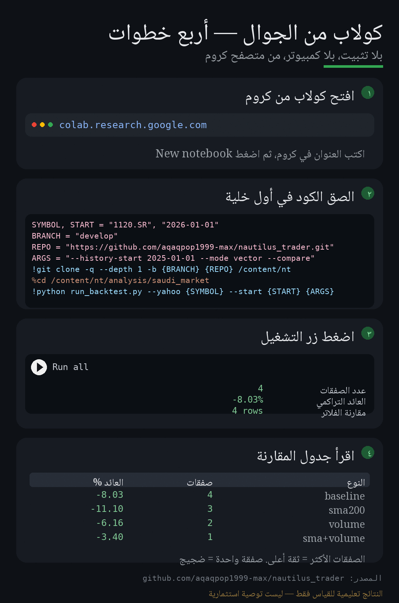
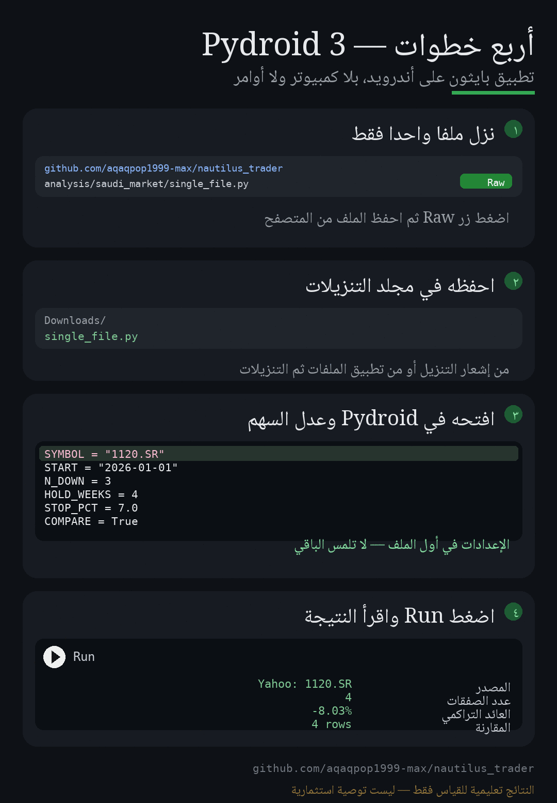

# دليل عملي: وش أسوي بهذي الملفات؟

هذي الملفات **ليست مؤشرًا للرسم البياني، ولا إضافة تُلصق في تطبيق تداول، ولا بوتًا يتصل بمحفظتك**.
هي **برنامج بايثون** يقرأ أسعارًا تاريخية، ويجيب على سؤال واحد برقم:

> «لو اشتريت بعد N أسابيع هبوط متتالية وبعت بعد H أسابيع — هل كنت سأربح أم أخسر؟ وهل إضافة فلتر
> (اتجاه السوق أو حجم التداول) تُحسّن النتيجة أم لا؟»

يعني: **أداة قياس**، لا أداة تنفيذ. لا ترسل أي أمر شراء، ولا تتصل بأي وسيط، ولا تحتاج مفاتيح API.

---

## ما الذي تستفيده فعليًا؟ (بالترتيب)

1. **تحوّل رأيًا إلى رقم.** بدل «السوق ارتد بعد 8 أسابيع هبوط، فرصة»، تحصل على: عدد الصفقات، نسبة
   الربح، متوسط العائد، أقصى تراجع، ومقارنة بالشراء والاحتفاظ.
2. **تختبر فكرتك قبل أن تخسر مالًا فيها.** غيّر المعاملات (`--n-down`، `--hold-weeks`، `--stop`،
   `--target`) وشاهد الفرق في ثوانٍ.
3. **تعرف الفلاتر التي «تبدو ذكية» لكنها لا تنفع.** `--compare` يقول لك بصراحة هل فلتر الاتجاه أو
   حجم التداول أضاف قيمة، أم قلّل الصفقات فقط.
4. **تفهم المخاطرة الحقيقية.** أقصى تراجع (maxDD) ونسبة الوقت في السوق أهم من رقم العائد الأخير.
5. **تعيد نفس التمرين على أي سهم سعودي** (الراجحي، الرياض، سابك، أرامكو...) في أي سنة.

**وما لا تستفيده:** لن يقول لك «اشترِ غدًا» ولا «بِع الآن»، ولن ينفذ صفقة، ولن يضمن نتيجة.

---

## على جوال أندرويد؟ ابدأ من هنا

لا تحتاج كمبيوترًا. ثلاث طرق مرتبة من الأسهل:

### أيّ الثلاث أختار؟ (باختصار)

| المعيار | Colab (أ) | Termux (ب) | Pydroid 3 (ج) |
|---|---|---|---|
| التثبيت | لا شيء (متصفح فقط) | تطبيق طرفية + أوامر | تطبيق واحد من Google Play |
| يحتاج حساب | حساب Google | لا | لا |
| الرسوم البيانية | ✅ جاهزة (matplotlib) | ❌ تحتاج خطوات إضافية | ⚠️ ممكنة لكنها محدودة |
| تحديث الكود لاحقًا | ✅ تلقائي (git clone) | ✅ `git pull` | ❌ تنزيل يدوي كل مرة |
| سهولة التعديل على الجوال | ✅ خلية واحدة | ⚠️ محرر نصوص (nano) | ✅ محرر مدمج (ملف واحد) |
| يناسب | المبتدئ والنتائج السريعة | من يكرّر التجربة ويريد تحكمًا كاملًا | من يريد تطبيقًا منفصلًا بلا متصفح |
| أكبر عقبة | يحتاج إنترنت دائم | أوامر الطرفية والكتابة عليها | تنزيل الملف يدويًا بعد كل تحديث |

**الخلاصة:**
- **جاهز الآن بأقل مجهود → Colab.** هو الوحيد الذي يعطيك الرسوم البيانية ويرسم منحنى رأس المال
  بدون أي إعداد، والوحيد الذي يُحدِّث نفسه تلقائيًا إن تغيّر الكود.
- **ستكرّر التجربة أسبوعيًا وتحب التحكم → Termux.** أقوى وأسرع بعد أول إعداد، ويعمل لاحقًا على
  ملفات CSV محفوظة عندك دون إنترنت.
- **تريد تطبيقًا بلا متصفح → Pydroid 3.** صار أسهل: ملف واحد (`single_file.py`) تنزّله وتفتحه
  وتضغط Run. عيبه الوحيد أن أي تحديث للكود يعني تنزيل الملف مرة أخرى.

### أ) Google Colab — الأسهل (مُوصى به)



**الطريقة الأضمن: دفتر جديد + خلية واحدة** (لا تعتمد على فتح رابط جاهز):

1. افتح <https://colab.research.google.com> من كروم ← **New notebook**.
2. الصق هذه الخلية، وعدّل `SYMBOL` و`START` فقط:

```python
SYMBOL, START = "1120.SR", "2026-01-01"
BRANCH = "develop"
REPO = "https://github.com/aqaqpop1999-max/nautilus_trader.git"
ARGS = "--history-start 2025-01-01 --mode vector --compare"
!git clone -q --depth 1 -b {BRANCH} {REPO} /content/nt
%cd /content/nt/analysis/saudi_market
!python run_backtest.py --yahoo {SYMBOL} --start {START} {ARGS}
```

3. اضغط ▶️ بجانب الخلية (أو **Runtime ← Run all**).

سترى النتيجة نصًّا عربيًّا: عدد الصفقات ← نسبة الربح ← أقصى تراجع ← ثم **جدول مقارنة الفلاتر**.

> تريد الرسم البياني؟ أضف `--export-trades trades.csv` إلى `ARGS`، ثم في خلية جديدة:
>
> ```python
> import pandas as pd
> df = pd.read_csv("trades.csv")
> df["exit_week"] = pd.to_datetime(df["exit_week"])
> df["equity"] = (1 + df["return"]).cumprod()
> display(df)
> df.plot(x="exit_week", y="equity", marker="o", title="منحنى رأس المال")
> ```

**بديل: فتح الدفتر الجاهز برابط** — قد يعمل مباشرة:

<https://colab.research.google.com/github/aqaqpop1999-max/nautilus_trader/blob/develop/analysis/saudi_market/Saudi_Dip_Backtest.ipynb>

إذا ظهر «**Notebook loading error**» فاستخدم الخلية أعلاه (تعمل دائمًا).
سبب الخطأ السابق أن الكود كان على فرع فيه شرطة مائلة؛ الآن صار على `develop` فالمفترض أن
يفتح الرابط مباشرة.

### ب) Termux (طرفية لينكس على أندرويد — مجاني)

> نزّل Termux من **F-Droid** أو من صفحة GitHub الرسمية، لا من Google Play
> (نسخة المتجر قديمة ومهملة وقد تفشل أوامر التثبيت).

```bash
pkg update && pkg install python git
git clone https://github.com/aqaqpop1999-max/nautilus_trader.git
cd nautilus_trader/analysis/saudi_market
python phone_run.py
```

`phone_run.py` مُعدّ للجوال: افتحه بأي محرر نصوص (أو `nano phone_run.py`) وعدّل القيم في أعلى
الملف (`SYMBOL`, `START`, `N_DOWN`, `HOLD_WEEKS`, `STOP_PCT`)، ثم شغّله كما هو بدون أي أوامر إضافية.

### ج) Pydroid 3 (تطبيق بايثون على أندرويد — من Google Play)



الأسهل: **ملف واحد فقط** (`single_file.py`) يجمع كل الأداة — بلا مجلدات وبلا استيراد.

1. نزّل الملف من هذا الرابط على جوالك:

   <https://github.com/aqaqpop1999-max/nautilus_trader/blob/develop/analysis/saudi_market/single_file.py>

   اضغط زر **Raw** ثم احفظ الملف (سيبقى في مجلد **Downloads**).
2. افتح تطبيق **Pydroid 3** ← أيقونة المجلد ← **Downloads** ← `single_file.py`.
3. في أول الملف عدّل `SYMBOL` (و`START` إن أردت)، ثم اضغط ▶️ **Run**.
4. اقرأ: عدد الصفقات ← نسبة الربح ← أقصى تراجع ← جدول مقارنة الفلاتر.

> إن نزّلت المشروع كاملًا (ZIP) وفككته، يمكن تشغيل `analysis/saudi_market/phone_run.py` بدل ذلك؛
> له نفس الإعدادات في أعلى الملف ونفس النتيجة.

> ملاحظة: وضع Nautilus (`--mode nautilus`) لا يعمل على الجوال؛ استخدم الوضع الافتراضي (المتجهات).

---

## المسار الأول (الأسهل): شغّله على جهازك — بدون تثبيت أي مكتبة

الأداة الأساسية مكتوبة بـ«المكتبة القياسية» فقط، فلا تحتاج `pip install` ولا إنترنت إلا لتحميل الأسعار.

### 1. ثبّت بايثون (مرة واحدة)

- حمّل من <https://www.python.org/downloads/> نسخة **3.10 أو أحدث**.
- **مهم على ويندوز:** أثناء التثبيت فعّل خيار **Add Python to PATH**.

تحقّق من التثبيت:

```bash
python --version
```

### 2. احصل على الملفات

إما:

```bash
git clone https://github.com/aqaqpop1999-max/nautilus_trader.git
cd nautilus_trader/analysis/saudi_market
```

أو نزّل مجلد `analysis/saudi_market` من صفحة المستودع على GitHub (Code → Download ZIP) وفكّه.

### 3. جرّب أول أمر (بدون إنترنت)

```bash
python run_backtest.py --demo
```

هذا يستخدم **بيانات وهمية** فقط للتأكد أن كل شيء يعمل. إذا ظهرت الجداول بدون أخطاء → جاهز.

### 4. شغّله على سهم حقيقي (يحتاج إنترنت)

رموز Yahoo للأسهم السعودية = رمز السهم + `.SR`:

| السهم | الرمز |
|---|---|
| مصرف الراجحي | `1120.SR` |
| البنك الأهلي السعودي | `1180.SR` |
| بنك الرياض | `1010.SR` |
| سابك | `2010.SR` |
| أرامكو | `2222.SR` |
| stc | `7010.SR` |

```bash
python run_backtest.py --yahoo 1120.SR --start 2026-01-01 --symbol 1120 --compare
```

### 5. اقرأ المخرجات بهذا الترتيب

1. **عدد الصفقات** — أقل من 10 = لا تستنتج شيئًا.
2. **أقصى تراجع** — هل تتحمل خسارة مؤقتة بهذا الحجم؟
3. **العائد التراكمي مقابل «الشراء والاحتفاظ»** — إذا كان أقل من مجرد شراء واحتفاظ، فالاستراتيجية لا تستحق.
4. **جدول المقارنة** — هل الفلاتر حسّنت أم قلّلت الصفقات فقط؟
5. **معامل الربح** — أقل من 1 = النظام خاسر إحصائيًا.

### 6. جرّب تعديلات صغيرة وتعلّم منها

```bash
# وقف خسارة أضيق
python run_backtest.py --yahoo 1120.SR --stop 4 --compare

# احتفاظ أسبوعين بدل أربعة
python run_backtest.py --yahoo 1120.SR --hold-weeks 2 --compare

# مسح كامل: n_down من 1 إلى 5 × مدة الاحتفاظ 2 إلى 8
python run_backtest.py --yahoo 1120.SR --sweep --quiet

# فلتر حجم أعلى
python run_backtest.py --yahoo 1120.SR --filter-volume --volume-mult 1.5
```

### 7. احفظ النتائج

```bash
python run_backtest.py --yahoo 1120.SR --export-trades trades-1120.csv --save-data data/1120.csv
```

افتح `trades-1120.csv` في Excel لترى كل صفقة: تاريخ الدخول والخروج، السعرين، العائد، سبب الخروج.

---

## المسار الثاني: Google Colab (بدون تثبيت شيء على جهازك)

مناسب إذا ما تحب تثبيت برامج على اللابتوب:

1. افتح <https://colab.research.google.com> ثم **New notebook**.
2. من أيقونة المجلد على اليسار اضغط **Upload** وارفع الملفات الخمسة
   (`run_backtest.py`, `saudi_data.py`, `signals.py`, `filters.py`, `vector_engine.py`).
3. في خلية جديدة اكتب:

   ```python
   !python /content/run_backtest.py --yahoo 1120.SR --start 2026-01-01 --compare
   ```

4. اقرأ الجداول في نفس الخلية.

> في Colab استخدم الوضع الافتراضي (محرك المتجهات). لا تحاول تشغيل `--mode nautilus` هناك
> (يحتاج بايثون 3.13 وبناء حزمة كبيرة).

---

## المسار الثالث: خلّه عليّ

أرسل لي: **اسم السهم + الفترة + القاعدة التي تريد اختبارها** (مثلًا: «سابك من 2024، شراء بعد
أسبوعين هبوط، بيع بعد 3 أسابيع، وقف 5%») وأنا أعدّل الأوامر وأشغّلها وأرسل لك النتائج وقراءتها.

---

## أين تُلصق الملفات؟ (توضيح الخطأ الشائع)

| المكان | هل يصلح؟ | لماذا |
|---|---|---|
| تطبيق الوسيط (الراجحي المالية، الأهلي، دراية...) | ❌ | التطبيقات لا تشغّل بايثون ولا تستقبل ملفات برمجية. |
| TradingView / منصات الرسوم | ❌ | تلك تستخدم لغتها الخاصة (Pine Script)، وليست بايثون. |
| مجلد على جهازك أو Colab | ✅ | هنا تُشغّل الملفات فعليًا. |
| المستودع على GitHub | ✅ | مكان حفظ النسخة ومشاركتها (وهو مكانها الحالي). |

المسار الصحيح دائمًا: **سكربت بايثون يعمل على جهاز/سحابة → يقرأ بيانات → يطبع نتائج**.
لا يوجد أي مسار يذهب من هذه الملفات إلى محفظتك مباشرة.

---

## مشاكل شائعة وحلولها

| الرسالة | المعنى | الحل |
|---|---|---|
| `python: command not found` | بايثون غير مثبت أو ليس في PATH | أعد التثبيت مع تفعيل Add to PATH، أو جرّب `py` على ويندوز |
| `ModuleNotFoundError: saudi_data` | شغّلت الملف من مجلد آخر | ادخل مجلد `analysis/saudi_market` ثم `python run_backtest.py ...` |
| `no valid bars parsed` | ملف CSV بأعمدة غير مفهومة | تأكد من وجود `date, open, high, low, close` أو استخدم `--date-format` |
| `Yahoo Finance returned no data` | رمز خاطئ أو الشبكة محجوبة | تأكد من `.SR` في نهاية الرمز، وجرّب متصفحك على نفس الرابط |
| `لا توجد بيانات كافية لمتوسط 200 يوم` | بياناتك تبدأ من 2026 فقط | استخدم `--index-csv` بتاريخ أطول أو `--start 2024-01-01` |
| نتائج غريبة جدًا | بيانات وهمية `--demo` | `--demo` للاختبار فقط، النتائج الحقيقية من `--yahoo` أو `--csv` |

---

## قيود يجب أن تعرفها قبل أن تثق بأي رقم

- **العيّنة صغيرة:** 2026 حتى الآن ≈ 44 أسبوعًا، وعدد الصفقات قليل. أي نتيجة إيجابية قد تكون حظًا.
- **البيانات المجانية فيها أخطاء وفجوات**، وأسعار Yahoo معدّلة وقد تختلف عن تداول.
- **لا تُنمذج:** التسوية T+2، حدود التذبذب ±10%، إيقاف التداول، العمق، وتوزيعات الأرباح.
- **الفلاتر تقلّل الصفقات**، فيصبح الحكم أصعب لا أسهل. الصدق مع النفس هنا أهم من رقم جميل.
- **مؤشر تاسي غير متوفر على Yahoo**؛ لاختباره صدّر تاريخه من تداول/أرقام إلى CSV واستخدم `--csv`.

---

## خلاصة في ثلاثة أسطر

1. هذه أداة **قياس** لفكرة تداول، تُشغّل على جهازك أو Colab، لا تُلصق في تطبيق وسيط.
2. تبدأ بـ `--demo` للتأكد، ثم `--yahoo 1120.SR --start 2026-01-01 --compare` لنتائج حقيقية.
3. تقرأ: عدد الصفقات ← أقصى تراجع ← المقارنة بالشراء والاحتفاظ ← ثم تقرر إن كانت الفكرة تستحق أصلًا.

وليست توصية استثمارية، ولا تعوّض عن استشارة مرخّص.
