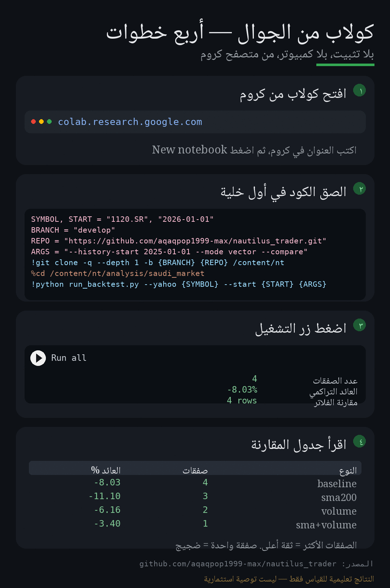

# اختبار استراتيجية «الشراء بعد أسابيع الهبوط المتتالية» — السوق السعودي 2026

> English summary: this folder backtests a "buy after N consecutive down weeks" system on Saudi
> equities (Tadawul), first with a dependency-free vector engine and then event-driven on the
> NautilusTrader **v2** backtest engine. See the Arabic sections below for the rules and usage.

هذه الحزمة تختبر فكرة بسيطة جدًا وبشكل قابل للتكرار:

> **إذا أغلق السوق (أو السهم) N أسابيع متتالية هبوطًا، اشترِ عند افتتاح الأسبوع التالي، واحتفظ H أسابيع.**

الفكرة مستوحاة مباشرة من موجة 2026: ثمانية أسابيع خسائر متتالية هي الأطول منذ 1994، ثم ارتداد
قوي من قاع 9,368 نقطة إلى ما فوق 10,000. السؤال: هل كان «الشراء بعد الهبوط» مُربحًا فعلًا، أم
أنه أسلوب يبدو بديهيًا ويخسر في الممارسة؟

---

## الملفات

| الملف | الوصف |
|---|---|
| `saudi_data.py` | تحميل البيانات (CSV / Yahoo / بيانات وهمية)، والتجميع الأسبوعي (الأحد ← الخميس). **بدون أي اعتماديات خارجية.** |
| `signals.py` | تعريف موحّد للإشارة (N أسابيع هابطة متتالية) وسلسلة الهبوط — يستخدمه المحرّكان والفلاتر. |
| `filters.py` | الفلاتر السياقية: شرط المتوسط المتحرك (SMA) للمؤشر، وشرط حجم التداول المرتفع، مع تشخيص لكل إشارة. |
| `vector_engine.py` | المحرك المرجعي: إشارات، صفقات، إحصاءات، تراجع أقصى، مقارنة بالشراء والاحتفاظ. |
| `nautilus_engine.py` | نفس القواعد لكن داخل `BacktestEngine` في NautilusTrader v2 (بارات أسبوعية، عمولات، محفظة SAR). |
| `run_backtest.py` | واجهة الأوامر التي تربط كل ما سبق. |
| `analytics.py` | تقرير تحليلي مرئي: متوسطات، VWAP، بروفايل حجم، وتقييم القاعدة — HTML بلا مكتبات. |
| `focus_report.py` | تحليل مفصّل **لسهم واحد**: اتجاه، مستويات دعم/مقاومة، حجم، القواعد الثلاث، والتحجيم — مع تقرير HTML صفحة واحدة. |
| `phone_run.py` | تشغيل مبسّط من مجلد المشروع (Termux/Pydroid): عدّل القيم أعلى الملف واضغط Run. |
| `single_file.py` | **ملف واحد** يضم الأداة كاملة (مُولَّد) — للحفظ على الجوال وتشغيله مباشرة. |
| `build_single_file.py` | يعيد توليد `single_file.py` بعد أي تعديل على الوحدات. |
| `Saudi_Dip_Backtest.ipynb` | دفتر Colab جاهز للجوال: إعدادات في خلية واحدة + رسم بياني للنتائج. |
| `HOWTO-AR.md` | دليل عملي بالعربي: من أين تبدأ، كيف تشغّل، وكيف تقرأ النتائج. |

---

## القواعد المنفذة بدقة (Rules)

1. **تعريف الأسبوع الهابط:** إغلاق الأسبوع أقل من إغلاق الأسبوع السابق. الأسبوع = الأحد ← الخميس.
2. **الإشارة:** آخر `n_down` أسبوعًا مكتملًا كلها هابطة.
3. **الدخول:** شراء بسعر **افتتاح الأسبوع التالي** للإشارة. لا يوجد تسريب مستقبلي (look-ahead):
   الإشارة لا تُعرف إلا عند إغلاق الأسبوع الأخير، والتنفيذ في أول سعر متاح بعده.
4. **الخروج:**
   - بعد `hold_weeks` أسبوعًا: بيع عند افتتاح أسبوع `الدخول + hold_weeks`.
   - أو قبل ذلك إذا أغلق الأسبوع تحت وقف الخسارة (`--stop`) أو فوق الهدف (`--target`)،
     والبيع حينها يكون عند **افتتاح الأسبوع التالي** (تحفّظ متعمد: لا تنفيذ داخل الأسبوع).
5. **مركز واحد في كل وقت**، بدون تعزيز، وبدون بيع مكشوف (السوق السعودي لا يسمح به).
6. **العمولات** على كل جانب (`--fee-bps`، الافتراضي 15.5 نقطة أساس ≈ 0.155% لكل جهة).

---

## التشغيل

### 0-ب) تحليل سهم واحد بالتفصيل (أرامكو أو غيره)

عندما تريد فحص سهم واحد قبل أي أمر، لا كل القائمة:

```bash
python analysis/saudi_market/focus_report.py                 # الافتراضي: أرامكو 2222
python analysis/saudi_market/focus_report.py --yahoo 1120.SR --name الراجحي
python analysis/saudi_market/focus_report.py --demo          # تجربة بلا إنترنت
```

يُنتج `focus_report.html`: خريطة مستويات (مقاومة/سعر/دعم)، اتجاه أسبوعي مع المتوسط الطويل،
عدد الأسابيع تحت المتوسط، RSI أسبوعي، حجم مقابل المتوسط، تكدّس الحجم، آخر 10 أسابيع،
وجدول تحجيم 20/50/100 ألف. ويمكن إضافة ملاحظات أساسية من ملف نصي بـ `--facts ملف.txt`.

مثال محفوظ (لقطة 12 نوفمبر 2026): [`docs/aramco-2026-11-12.html`](docs/aramco-2026-11-12.html).

### 0) من الجوال (أندرويد) — الأسرع

افتح دفتر Colab مباشرة من هذا الرابط ثم **Run all**:

<https://colab.research.google.com/github/aqaqpop1999-max/nautilus_trader/blob/develop/analysis/saudi_market/Saudi_Dip_Backtest.ipynb>

أو من Termux: `pkg install python git` ثم `python phone_run.py`.



التفاصيل الكاملة في [`HOWTO-AR.md`](HOWTO-AR.md).

### 1) فحص سريع بدون إنترنت وبدون NautilusTrader

```bash
python analysis/saudi_market/run_backtest.py --demo
```

يستخدم بيانات وهمية (2025 → نوفمبر 2026) فقط للتحقق من أن خط الأنابيب يعمل، وتبدأ من 2025 كي
يتوفر تاريخ كافٍ لمتوسط 200 يوم عند تفعيل الفلاتر. **لا تُبنى عليها أي نتيجة.**

### 2) بيانات 2026 الحقيقية من Yahoo Finance

```bash
# الراجحي (2026 حتى اليوم)
python analysis/saudi_market/run_backtest.py --yahoo 1120.SR --start 2026-01-01 --symbol 1120

# بنك الرياض، سابك، أرامكو...
python analysis/saudi_market/run_backtest.py --yahoo 1010.SR --start 2026-01-01 --symbol 1010
python analysis/saudi_market/run_backtest.py --yahoo 2010.SR --start 2026-01-01 --symbol 2010
```

مع حفظ البيانات محليًا لإعادة الاستخدام السريع:

```bash
python analysis/saudi_market/run_backtest.py --yahoo 1120.SR --save-data analysis/saudi_market/data/1120_2026.csv
```

> **قيد مهم:** Yahoo لا يوفّر تاريخًا لمؤشر `^TASI.SR` (يرجع نقطة واحدة فقط). لاختبار المؤشر
> نفسه، نزّل تاريخ تاسي اليومي من تداول السعودية أو من أرقام إلى CSV ثم استخدم `--csv`.

### 3) ملف CSV من تصدير تداول / أرقام / Excel

```bash
python analysis/saudi_market/run_backtest.py --csv analysis/saudi_market/data/tasi_daily_2026.csv --symbol TASI
```

الأعمدة المطلوبة: `date, open, high, low, close` (و`volume` اختياري). أسماء الأعمدة العربية
مدعومة أيضًا (`التاريخ`, `الافتتاح`, `الأعلى`, `الأدنى`, `الإغلاق`, `الكمية`). إذا كان التاريخ
بصيغة غير معروفة استخدم `--date-format "%d/%m/%Y"`.

### 4) الفلاتر السياقية (النسخة المحسّنة)

الفكرة الخام «اشترِ بعد هبوط» تعطي نفس الوزن لهبوط داخل اتجاه صاعد وهبوط داخل انهيار.
أضفنا فلترين، كل منهما مستقل ويمكن دمجهما:

| الفلتر | الشرط | الافتراضي | المبرر |
|---|---|---|---|
| الاتجاه (SMA) | إغلاق المرجع (المؤشر) **أعلى** من متوسطه المتحرك لـ N يومًا عند إغلاق أسبوع الإشارة | N = 200 | الشراء داخل اتجاه صاعد يختلف عن الشراء داخل سوق هابط. هبوط 2026 كان جيوسياسيًا والسوق تحته متوسطه. |
| الحجم | حجم أسبوع الإشارة ≥ ×mult من متوسط آخر k أسبوعًا | ×1.2، k=20 | هبوط بحجم ضخم أقرب إلى استسلام بيعي (capitulation) من انزلاق هادئ. |

```bash
# مقارنة: الأساس مقابل كل فلتر ومقارنة الاثنين معًا (هذا هو المطلوب أساسًا)
python analysis/saudi_market/run_backtest.py --yahoo 1120.SR --compare

# فلتر الاتجاه على المؤشر الحقيقي (تصدير تاسي إلى CSV)
python analysis/saudi_market/run_backtest.py --yahoo 1120.SR \
    --filter-sma --index-csv analysis/saudi_market/data/tasi_daily.csv

# فلتر الاتجاه على المؤشر من Yahoo (أي رمز مؤشر متاح هناك)
python analysis/saudi_market/run_backtest.py --yahoo 1010.SR --filter-sma --index-yahoo ^TASI.SR

# فلتر الحجم فقط، بحد أدنى 1.5× ومتوسط 30 أسبوعًا
python analysis/saudi_market/run_backtest.py --yahoo 1120.SR --filter-volume --volume-mult 1.5 --volume-lookback 30
```

مخرجات المقارنة (هذه من البيانات الوهمية `--demo --compare --filter-sma`، للشكل فقط):

```
variant           trades  win%    avg%     cum%     maxDD%   exposure  blocked
------------------------------------------------------------------------------------
baseline              5   40.0   -1.70    -9.12    12.15     18.2       0
sma200                3   33.3   -3.59   -11.10    11.10     10.1       8
volume>=1.20x         3   33.3   -1.78    -5.29     6.16     12.1      12
sma+volume            1    0.0   -3.40    -3.40     3.40      4.0      14
(blocked = إشارات منعتها الفلاتر)
```

**كيف تقرأها:** الفلتر الجيد يقلّل عدد الصفقات ويقلّل التراجع الأقصى **ويحافظ أو يحسّن** العائد،
لا أن يرفع العائد فقط عبر حذف الصفقات الخاسرة بأثر رجعي. إذا تقلّصت الصفقات إلى 2–3 فلا حكم أصلًا.

ملاحظات تشغيلية:
- إذا لم يوجد تاريخ كافٍ لمتوسط 200 يوم (بيانات 2026 وحدها مثلًا)، فالإشارات تُمنع بأمان
  ويظهر ذلك في التشخيص (`مُنعت (نقص بيانات)`) مع تحذير. الحل: `--start 2024-01-01` أو `--index-csv`
  بتاريخ أطول.
- الفلاتر مبنيّة على معلومات معروفة عند **إغلاق أسبوع الإشارة** فقط، بلا تسريب مستقبلي.
- في محرك Nautilus تُمرَّر الإشارات المسموحة مسبقًا (`allowed_weeks`) لتبقى القواعد متطابقة.

### 5) المسح الشبكي للمعاملات (تجنّب الانحياز لمعامل واحد)

```bash
python analysis/saudi_market/run_backtest.py --yahoo 1120.SR --sweep --quiet
```

يطبع العائد التراكمي لكل تركيب من `n_down × hold_weeks`.

### 6) التشغيل على محرك NautilusTrader v2 (حدثي)

المتطلب: بايثون 3.13+ والحزمة v2 (نفس نسخة هذا المستودع `v2.0.0rc8`):

```bash
uv venv --python 3.13
source .venv/bin/activate
uv pip install --pre nautilus_trader

python analysis/saudi_market/run_backtest.py --yahoo 1120.SR --mode nautilus
```

أو من داخل مستودع مبنٍ من المصدر:

```bash
uv run --project python --no-sync python analysis/saudi_market/run_backtest.py --yahoo 1120.SR --mode nautilus
```

الوضع الافتراضي `--mode auto` يشغّل المحرك المرجعي دائمًا، ويضيف NautilusTrader إن كان مثبتًا،
ثم يقارن عدد الصفقات بين المحرّكين كاختبار تقاطع (cross-check).

---

## ماذا تطبع الأداة؟

```
=== البيانات ===        الرمز، المصدر، الفترة، عدد الأيام/الأسابيع، أعلى وأدنى إغلاق، عدد الإشارات
=== الصفقات ===         سطر لكل صفقة: تاريخ الدخول → الخروج، السعرين، العائد، المدة، سبب الخروج
=== النتائج ===         عدد الصفقات، نسبة الربح، متوسط/أفضل/أسوأ صفقة، معامل الربح،
                        العائد التراكمي، أقصى تراجع، نسبة الوقت في السوق، عائد الشراء والاحتفاظ
```

`--export-trades analysis/saudi_market/data/trades.csv` يحفظ الصفقات، و`--save-data` يحفظ البيانات اليومية.

---

## قراءة النتائج بصدق (كيف تحكم على الفكرة)

* **عدد الصفقات هو أهم رقم.** إذا كانت النتيجة «+40%» مبنية على صفقتين، فهي ضوضاء لا إشارة.
  في 2026 (نحو 44 أسبوعًا) ستكون النتائج **استقرائية للغاية**؛ وسّع الفترة إلى 2015–2026 قبل أي حكم.
* **قارن دائمًا بالشراء والاحتفاظ.** استراتيجية تربح 8% بينما السهم ربح 25% ليست نجاحًا.
* **انظر إلى أقصى تراجع**، لا إلى العائد فقط. نظام يخسر 20% مؤقتًا يحتاج أعصابًا لا يملكها كثيرون.
* **جرّب المسح الشبكي (`--sweep`) ثم شكّ في أفضل خلية.** أفضل تركيبة في 43 أسبوعًا غالبًا انحياز
  إلى الماضي (overfitting) وليست ميزة حقيقية.
* **عند التحقق على 2026 تحديدًا:** الهبوط جاء من صدمة جيوسياسية (هجمات على منشآت ومطارات، تهديد
  هرمز) وليس من دورة أرباح. أي نظام يعتمد على «الارتداد بعد الهبوط» يفشل عندما يكون الهبوط
  مبرَّرًا بأساسيات، وينجح عندما يكون ذعرًا. لذلك: **افصل بين اشتراك السوق (index) واشتراك السهم**.

---

## القيود المعروفة (Known limitations)

| القيد | الأثر |
|---|---|
| نمذجة التسوية T+2 غير مشمولة | الأثر ضئيل على إطار أسبوعي، لكنه موجود للمضاربة اليومية. |
| لا تُنمذج حدود التذبذب ±10% ولا إيقاف التداول | صفقات كان يمكن تعليقها في السوق الحقيقي تُنفَّذ هنا. |
| لا تُنمذج السيولة العميقة/الانزلاق | الباكتيست يفترض التنفيذ على الافتتاح؛ الأسهم الصغيرة قد تنزلق أكثر. |
| توزيعات الأرباح غير مشمولة في العائد | عوائد البنوك (4–6%) تُقلّل من العائد الحقيقي المحتسب. |
| التعديلات على رأس المال (منح/تجزئة) | استخدم أسعارًا معدَّلة من المصدر (Yahoo يعدّلها تلقائيًا). |
| حجم التدويس (tick) متغيّر في تداول | يُستنتج آليًا من الأسعار؛ راجع `infer_price_increment_from_prices`. |
| `MakerTakerFeeModel` كنسبة من القيمة | قد يختلف عن عمولة وسيطك (0.155% + ضريبة 15% على العمولة). |
| فلتر الاتجاه يحتاج تاريخ مرجع طويل | بدون 200 يوم سابقة تُمنع الإشارات (fail-safe) ويظهر تحذير. |
| Nautilus v2 لم يُختبر في بيئة هذا الفرع | المسار مُختبَر منطقيًا مقابل المحرك المرجعي، لكن شغّله أولًا على `--demo`. |

---

## أفكار للتطوير (إن أردت المتابعة)

1. ~~فلتر سياق (SMA 200 / حجم تداول)~~ — **تم تنفيذه في `filters.py`** (`--filter-sma`,
   `--filter-volume`, `--compare`).
2. **سلة أسهم بدل سهم واحد:** إشارة على تاسي، وتنفيذ على 5–10 أسهم كبيرة بأوزان متساوية.
3. **أوامر فعلية للوقف:** تحويل الوقف من «إغلاق أسبوعي» إلى `stop_market` داخل الأسبوع
   (`order_factory.stop_market`) لمحاكاة أمر الوقف الحقيقي.
4. **مقارنة بمعيار:** نسبة شارب/سورتينو مقابل الشراء والاحتفاظ، لا العائد المطلق فقط.
5. **توسيع البيانات:** 2015–2026 مع الأزمات (2020، 2022) لمعرفة إن كانت الفكرة تصمد خارج 2026.

---

## إخلاء المسؤولية

الكود والنتائج لأغراض تعليمية وبحثية فقط، وليست توصية استثمارية. الباكتيست لا يضمن الأداء
المستقبلي، والبيانات المجانية قد تحتوي أخطاء أو فجوات. راجع الأرقام مع مصدرك الرسمي قبل أي قرار.
